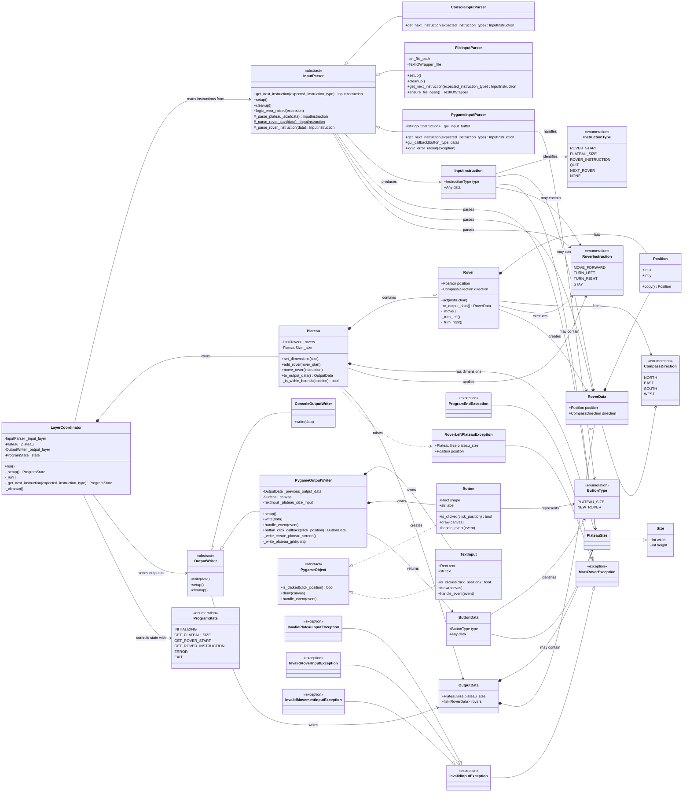

# Mars Rover UML class diagram

The diagram below describes the principal classes, enums, and relationships in
the `mars_rover/src` package. It reflects the current implementation,
including the console and Pygame adapters.

## Layer overview

- **Coordinator:** `LayerCoordinator` drives the state machine and connects
  input, domain logic, and output.
- **Input layer:** `InputParser` defines the adapter contract; console, file,
  and Pygame implementations convert external input into `InputInstruction`.
- **Logic layer:** `Plateau` owns the active rovers and enforces bounds and
  collision rules; `Rover` applies movement instructions.
- **Output layer:** `OutputWriter` defines the rendering contract. The console
  and Pygame writers consume `OutputData`.
- **Common model:** value/data objects (`Position`, `Size`, `PlateauSize`,
  `RoverData`, `InputInstruction`, `OutputData`) and enums are shared across
  layers.
