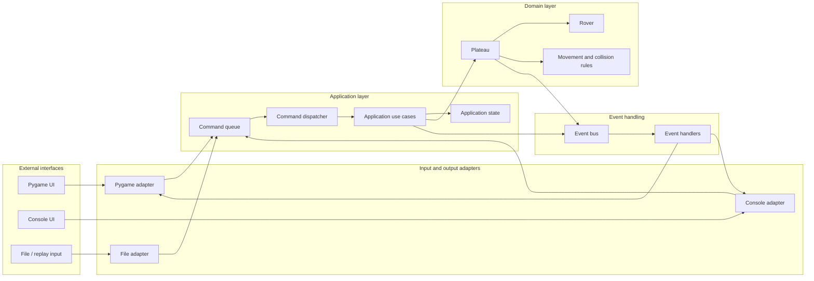
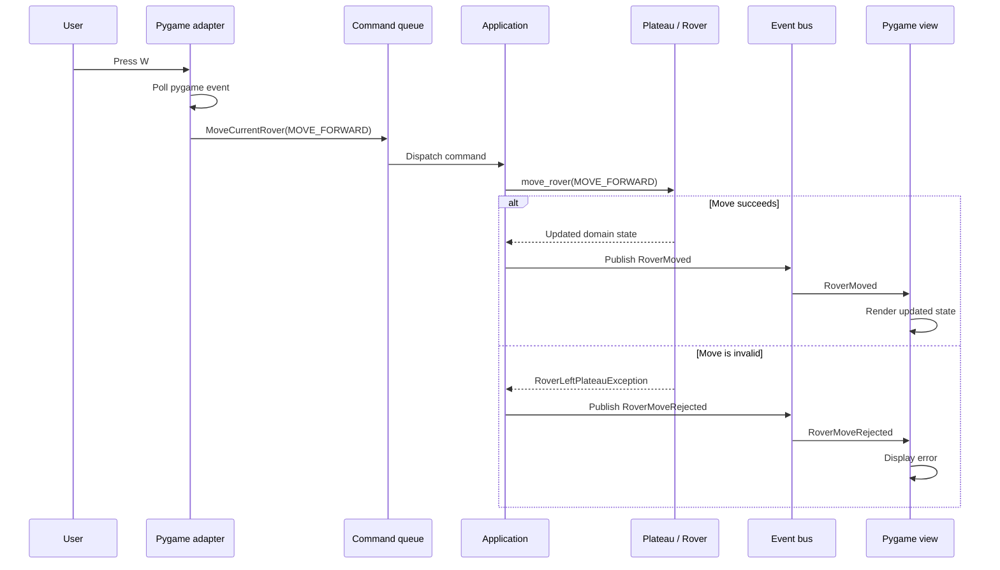

## Option C: Event-driven application

An event-driven design means the application responds to things that happened rather than having one central coordinator constantly deciding what to ask for next.

Instead of:

```text
Coordinator asks for input
    -> input parser returns instruction
    -> coordinator updates plateau
    -> coordinator asks output layer to render
```

the flow becomes:

```text
External event
    -> command
    -> application use case
    -> domain change
    -> domain/application event
    -> subscribers react
```

For this project, it is useful to distinguish **three different kinds of events**.

---

## 1. UI events

These are events produced by an external interface.

Examples:

```python
PygameKeyPressed("w")
PygameMouseClicked(position)
PygameQuitRequested()
TextSubmitted("5 5")
```

They are specific to Pygame or the console and should not enter the domain layer directly.

For example, the domain should not know that moving a rover came from the `W` key. It should receive a domain-level command such as:

```python
MoveRover(RoverInstruction.MOVE_FORWARD)
```

A Pygame adapter translates UI events into application commands.

---

## 2. Commands

A command expresses something the user or another client wants the application to do.

Examples:

```python
CreatePlateau(size)
AddRover(position, direction)
MoveCurrentRover(MOVE_FORWARD)
TurnCurrentRover(LEFT)
FinishCurrentRover()
QuitApplication()
```

Commands represent an intention.

They are usually handled by one application component:

```text
Command -> one command handler
```

For example:

```text
MoveCurrentRover(MOVE_FORWARD)
    -> RoverApplication.handle_move_rover(...)
```

The command handler invokes the domain model and decides what should happen if the operation succeeds or fails.

A command is not the same as an event:

```text
Command: "Move the rover forward"
Event:   "The rover moved forward"
```

The command is a request. The event is a fact.

---

## 3. Domain or application events

Events represent something that has already happened.

Examples:

```python
PlateauCreated(size)
RoverAdded(rover)
RoverMoved(rover_id, old_position, new_position)
RoverTurned(rover_id, direction)
RoverMoveRejected(reason)
RoverCollisionDetected(position)
ApplicationQuit
```

Events can be consumed by multiple parts of the system.

For example, after a rover moves:

```text
RoverMoved
    -> Pygame view redraws
    -> event logger records it
    -> replay recorder stores it
    -> statistics component updates
```

The domain event does not need to know which consumers exist.

---

# High-level system diagram



A simpler interpretation is:

```text
+------------------+
| Pygame / Console |
+--------+---------+
         |
         | UI events
         v
+------------------+
| Adapter          |
| event translator |
+--------+---------+
         |
         | Commands
         v
+------------------+
| Application      |
| command handlers |
+--------+---------+
         |
         | calls
         v
+------------------+
| Domain           |
| Plateau / Rover  |
+--------+---------+
         |
         | domain events
         v
+------------------+
| Event bus        |
+--------+---------+
         |
         | notifications
         v
+------------------+
| Views / logging  |
| replay / effects |
+------------------+
```

---

# Runtime example: moving a rover in Pygame

Suppose the user presses `W`.

## Step 1: Pygame produces a UI event

```text
pygame.KEYDOWN(key=W)
```

Only the Pygame adapter should read this event.

This is important because the current implementation has both `PygameInputParser` and `PygameOutputWriter` interacting with Pygame events. In an event-driven design, one UI component owns event polling.

## Step 2: The adapter creates a command

```python
MoveCurrentRover(RoverInstruction.MOVE_FORWARD)
```

The Pygame-specific key code is no longer relevant after this point.

The same command could also come from:

```text
Console input: M
File input:    M
Network input: move-forward
Automated test: MoveCurrentRover(MOVE_FORWARD)
```

## Step 3: The command is dispatched

```python
dispatcher.dispatch(
    MoveCurrentRover(RoverInstruction.MOVE_FORWARD)
)
```

The dispatcher finds the appropriate application handler.

Conceptually:

```python
def handle_move_current_rover(command):
    plateau.move_rover(command.instruction)
```

The application layer can also verify workflow rules, such as:

- A plateau must exist first
- A rover must already have been added
- The application must not be quitting
- The correct rover must be active

## Step 4: The domain applies the operation

The application calls `Plateau.move_rover`, which delegates movement to `Rover.act`.

The domain checks:

- plateau boundaries
- rover collisions
- valid movement
- resulting rover position

The domain should not know that the original cause was a key press.

## Step 5: The application publishes an event

If successful:

```python
RoverMoved(
    rover_id=0,
    old_position=Position(1, 2),
    new_position=Position(1, 3),
)
```

If unsuccessful:

```python
RoverMoveRejected(
    rover_id=0,
    reason="The rover would leave the plateau",
)
```

The current design raises exceptions such as `RoverLeftPlateauException`. That can continue to work, but the application layer should catch the expected domain exception and translate it into an application result or event.

The domain should not call the UI directly.

## Step 6: Subscribers react

The Pygame view receives the updated state or event and redraws:

```text
RoverMoved
    -> update displayed plateau
    -> update rover position
```

An error handler could display:

```text
RoverMoveRejected
    -> show "The rover cannot leave the plateau"
```

A future recorder could also receive the same event:

```text
RoverMoved
    -> append movement to replay log
```

---

# Event-driven version of the full application flow



---

# Where the application state fits

The domain state and application state should be separate.

## Domain state

The domain state is concerned with the simulation:

```python
class Plateau:
    size
    rovers
```

It should contain facts such as:

- rover positions
- rover directions
- plateau dimensions
- occupancy and collision rules

## Application state

The application state is concerned with the current user workflow:

```python
class ApplicationState:
    screen
    active_rover
    error_message
    is_running
    is_accepting_plateau_size
    is_accepting_rover_start
```

For example, the domain may contain a valid empty plateau while the application is currently displaying the “create rover” screen.

That distinction matters because the Pygame UI needs state that is not part of the Mars Rover domain.

---

# Recommended component structure

A practical structure could look like this:

```text
mars_rover/
    domain/
        plateau.py
        rover.py
        events.py
        exceptions.py

    application/
        commands.py
        application_state.py
        command_dispatcher.py
        rover_application.py

    infrastructure/
        event_bus.py
        replay_recorder.py

    adapters/
        console/
            console_adapter.py
        pygame/
            pygame_adapter.py
            pygame_view.py
        file/
            file_command_source.py

    parsing/
        instruction_parser.py
```

The names are not mandatory. The important boundaries are:

```text
Pygame adapter
    owns pygame.event.get()

Application
    owns workflow and command dispatch

Domain
    owns simulation rules

View
    owns rendering

Event bus
    distributes facts after state changes
```

---

# What the event bus does

An event bus is a mechanism for publishing events to interested subscribers.

Conceptually:

```python
event_bus.publish(RoverMoved(...))
```

Subscribers register handlers:

```python
event_bus.subscribe(RoverMoved, pygame_view.handle_rover_moved)
event_bus.subscribe(RoverMoved, replay_recorder.record)
```

The bus does not need to be complicated. For this project, a small in-process implementation would be sufficient.

However, you may not need a full event bus initially. You can start with:

```python
events = application.dispatch(command)

for event in events:
    pygame_ui.handle(event)
```

This keeps event flow explicit and avoids introducing global state.

A useful progression is:

```text
Phase 1: application returns events
Phase 2: application publishes events to local subscribers
Phase 3: add logging, replay, or other subscribers if needed
```

---

# Error handling in an event-driven design

There are two reasonable approaches.

## Approach 1: Exceptions inside the domain, events outside

```python
try:
    plateau.move_rover(instruction)
except RoverLeftPlateauException as error:
    return RoverMoveRejected(error)
```

This is a good fit for the existing project because it preserves the current domain exceptions.

The application layer converts expected exceptions into user-facing events.

Unexpected programming errors should still propagate rather than being silently converted into a normal UI error.

## Approach 2: Result objects

The domain returns a result:

```python
result = plateau.move_rover(instruction)

if result.failed:
    ...
```

This can make expected failure paths explicit, but it would require a larger change to the current code.

For your current codebase, I would prefer **exceptions in the domain and explicit translation in the application layer**.

---

# What happens to the current `LayerCoordinator`?

The current `LayerCoordinator` would become thinner or disappear into multiple components.

Its responsibilities are currently mixed:

- setting up input
- setting up output
- deciding application state
- requesting instructions
- executing domain operations
- forwarding logic errors to the input layer
- rendering after each operation
- cleaning up resources

In an event-driven design, these responsibilities could become:

```text
Application:
    command handling
    workflow state
    domain interaction

Pygame adapter:
    event polling
    event-to-command translation
    lifecycle management

Pygame view:
    rendering

Console adapter:
    reading and displaying console content
```

The main loop could then become conceptually:

```python
while application.is_running:
    ui_events = ui.poll_events()

    for ui_event in ui_events:
        command = ui.translate(ui_event)

        if command is not None:
            events = application.dispatch(command)
            ui.handle_application_events(events)

    ui.render(application.state)
```

For Pygame, this is especially natural because the application is already frame-oriented.

---

# Benefits

## Pygame and console become interchangeable

Both can produce the same application commands:

```text
Pygame W key       -> MoveCurrentRover(MOVE_FORWARD)
Console "M"        -> MoveCurrentRover(MOVE_FORWARD)
File "M"           -> MoveCurrentRover(MOVE_FORWARD)
```

The domain does not care which interface was used.

## Rendering is decoupled from mutation

The code that changes the plateau does not need to know how to redraw it.

## Multiple reactions become easy

One event can trigger multiple independent behaviors:

```text
RoverMoved
    -> redraw UI
    -> save replay
    -> update statistics
    -> emit sound
```

## Testing becomes simpler

You can test the application without starting Pygame:

```python
application.dispatch(
    MoveCurrentRover(RoverInstruction.MOVE_FORWARD)
)
```

You can test the Pygame adapter independently by giving it synthetic Pygame events and checking the commands it produces.

## Future features fit naturally

Event-driven architecture is particularly useful for:

- replaying movements
- undo and redo
- animation
- sound effects
- move history
- network clients
- multiple views
- automated simulations

---

# Costs and risks

Event-driven architecture is not automatically better. It introduces:

- more types
- indirect control flow
- command and event naming decisions
- more debugging paths
- potential event ordering issues
- risk of overusing a global event bus

For a small project, I would avoid:

- a distributed message broker
- asynchronous queues unless needed
- dozens of tiny event classes prematurely
- allowing every component to subscribe to everything
- making domain objects publish directly to UI objects

A simple synchronous event flow is sufficient:

```text
poll -> command -> application -> domain -> events -> render
```

---

# Recommended version for your project

I would use a **synchronous event-driven architecture**, not a fully asynchronous one:

```text
Pygame event queue
    -> Pygame adapter
    -> application command
    -> command handler
    -> Plateau / Rover
    -> application event
    -> Pygame view
```

The first useful event and command types could be:

```text
Commands:
    CreatePlateau
    AddRover
    MoveCurrentRover
    FinishCurrentRover
    QuitApplication

Events:
    PlateauCreated
    RoverAdded
    RoverMoved
    RoverTurned
    CommandRejected
    ApplicationQuit
```

The design can initially avoid a formal event bus. Have the application return events directly:

```python
events = application.dispatch(command)
ui.handle_events(events)
```

If replay, logging, animation, or multiple consumers become important, introduce an event bus later.

The core design principle is:

```text
Interfaces generate commands.
The application executes commands.
The domain changes state.
Events describe what happened.
Views react to events or render current state.
```

That would address the current Pygame coupling while keeping the domain model independent from the interface.